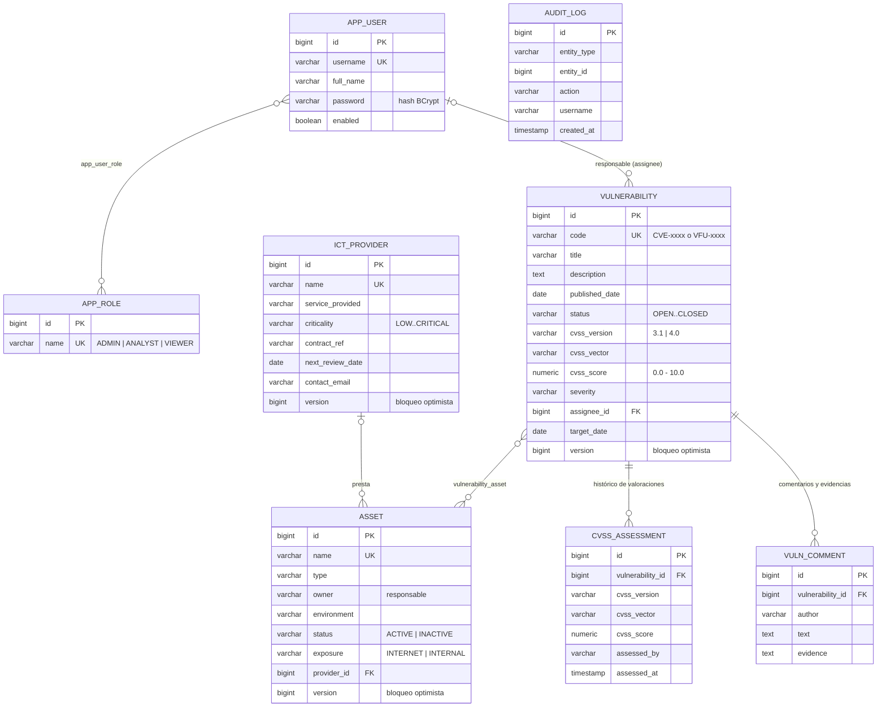

# Base de datos — VulnFollowUp

**Motor:** PostgreSQL 16. Se levanta con `docker compose up` desde la raíz de `vulnfollowup/`.

**Scripts:** las migraciones de Flyway están en
[`backend/src/main/resources/db/migration`](../backend/src/main/resources/db/migration).
El backend las ejecuta solo al arrancar (CU1), así que la BD se crea igual en cualquier ordenador.

| Script | Contenido |
|---|---|
| `V1__schema.sql` | Esquema completo: tablas, claves, relaciones N:M, CHECK de CVSS e índices |
| `V2__seed_security.sql` | Roles (ADMIN, ANALYST, VIEWER) y los 3 usuarios de prueba con contraseña BCrypt |

## Modelo entidad-relación



## Decisiones de diseño

- **N:M vulnerabilidad ↔ activo** con la tabla intermedia `vulnerability_asset`, porque una CVE (p. ej. Log4Shell) puede afectar a varios activos, y un activo tiene varias vulnerabilidades.
- **N:1 activo → proveedor TIC**: cada activo lo presta como mucho un proveedor. Así, para el informe por proveedor de SGE basta con un `JOIN`.
- **La valoración CVSS vigente se guarda en `vulnerability`**, y el histórico completo en `cvss_assessment`. Es una desnormalización controlada: los filtros por puntuación y severidad (los más usados) no necesitan buscar "la última valoración" con una subconsulta en cada listado.
- **La integridad también está en la BD**, no solo en Java. Dos `CHECK` rechazan una versión 4.0 con un vector `CVSS:3.1/…` y una severidad que no corresponde a la puntuación. Aunque alguien inserte datos a mano o un cliente se salte la API, la BD sigue siendo coherente.
- **`version` + `@Version` (bloqueo optimista)** en las tablas que editan varios usuarios: si dos analistas guardan a la vez, el segundo recibe `409 Conflict` en lugar de pisar el cambio del primero.
- **`audit_log`** registra quién cambió qué y cuándo. Es la evidencia que pide DORA, y además el recurso compartido de la demo de concurrencia (PSP).
- **Los activos no se borran, se desactivan** (`status = INACTIVE`), para no perder el historial de vulnerabilidades y auditoría.
- **Índices** en las columnas por las que se filtra (estado, severidad, puntuación, responsable).

## Prueba de integridad (manual, con psql)

```sql
-- Debe FALLAR: versión 4.0 con vector 3.1 (chk_vuln_vector_version)
INSERT INTO vulnerability(code,title,description,published_date,cvss_version,cvss_vector,cvss_score,severity)
VALUES ('VFU-T1','t','t','2026-01-01','4.0','CVSS:3.1/AV:N',9.8,'CRITICAL');

-- Debe FALLAR: severidad LOW con 9.8 (chk_vuln_severity_score)
INSERT INTO vulnerability(code,title,description,published_date,cvss_version,cvss_vector,cvss_score,severity)
VALUES ('VFU-T2','t','t','2026-01-01','3.1','CVSS:3.1/AV:N',9.8,'LOW');
```
